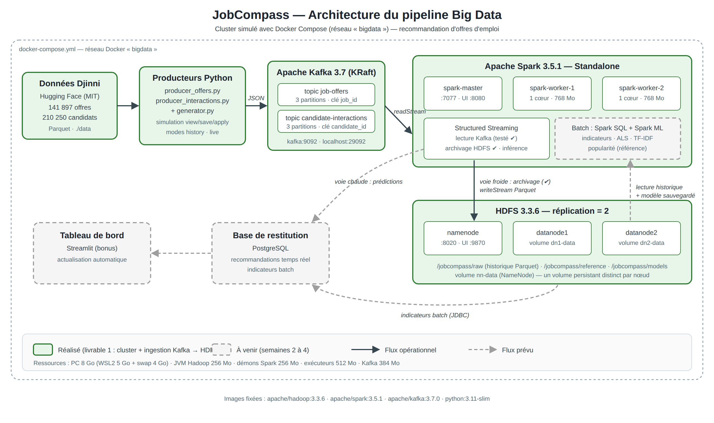

# JobCompass — Pipeline Big Data de recommandation d'offres d'emploi

Plateforme de recommandation d'offres d'emploi basée sur les compétences et le profil des candidats.
Projet des modules **Big Data Plateformes** et **Big Data Analytics** (Pr. El Ghali Btihal).

Le pipeline collecte un flux d'événements dans **Kafka**, l'archive dans **HDFS**, produit des analyses
historiques et entraîne un modèle de recommandation avec **Spark ML**, puis réalise des recommandations
en temps réel avec **Spark Structured Streaming**. Le tout tourne sur un cluster distribué simulé avec **Docker**.



## État d'avancement

| Livrable | Contenu | État |
|---|---|---|
| 1 | Cluster Docker (HDFS, Spark, Kafka), architecture, couche d'ingestion Kafka → HDFS | ✅ Réalisé |
| 2 | Indicateurs batch (Spark SQL) | ⏳ À venir |
| 3 | Pipeline ML (ALS, TF-IDF, popularité), évaluation, tuning | ⏳ À venir |
| 4 | Inférence temps réel, base de restitution, tableau de bord | ⏳ À venir |

## Pile technique (versions fixées)

| Composant | Image / version | Rôle |
|---|---|---|
| HDFS | `apache/hadoop:3.3.6` | Stockage distribué : 1 NameNode + 2 DataNodes, réplication 2 |
| Spark | `apache/spark:3.5.1` | Traitement : 1 Master + 2 Workers (Standalone) |
| Kafka | `apache/kafka:3.7.0` | Ingestion : broker unique en mode KRaft (sans Zookeeper) |
| Producteurs | `python:3.11-slim` + `confluent-kafka 2.5.3` | Publication des offres et des interactions |

## Arborescence

```
JobCompass/
├── docker-compose.yml        # Définition de tout le cluster
├── .env.example              # Variables d'environnement (à copier en .env)
├── infra/
│   ├── hadoop.env            # Configuration HDFS (réplication, ports, mémoire)
│   └── spark-defaults.conf   # Valeurs par défaut de spark-submit
├── ingestion/
│   ├── download_data.py      # Téléchargement des datasets Djinni (Hugging Face)
│   ├── inspect_data.py       # Inspection des colonnes
│   ├── generator.py          # Simulation des interactions candidat ↔ offre
│   ├── producer_offers.py    # Producteur Kafka : topic job-offers
│   ├── producer_interactions.py  # Producteur Kafka : topic candidate-interactions
│   ├── Dockerfile
│   └── requirements.txt
├── batch/
│   ├── test_hdfs.py          # Test Spark ↔ HDFS (réplication)
│   └── check_raw.py          # Vérification de l'historique archivé
├── streaming/
│   ├── test_kafka_stream.py  # Test de lecture Kafka (console)
│   └── archive_to_hdfs.py    # Archivage Kafka → HDFS en Parquet (voie froide)
├── dashboard/                # Tableau de bord (à venir)
└── docs/
    ├── architecture.png / .svg
    ├── donnees.md            # Documentation des données et de la simulation
    └── preuves/              # Captures de validation
```

## Prérequis

- **Docker Desktop** avec le moteur WSL 2 (Windows) ou Docker Engine + Docker Compose v2 (Linux/macOS).
- **8 Go de RAM minimum**. Sous Windows, donner au moins 5 Go à WSL (voir ci-dessous).
- **Python 3** et `pip`, uniquement pour télécharger les données.
- Environ **8 Go d'espace disque** (images Docker + données).

### Réglage de la mémoire WSL (Windows, PC 8 Go)

Dans PowerShell :

```powershell
Set-Content -Path "$env:USERPROFILE\.wslconfig" -Value "[wsl2]`nmemory=5GB`nswap=4GB"
wsl --shutdown
```

Puis relancer Docker Desktop. La configuration du cluster est déjà allégée pour tenir dans cette mémoire.

## Lancement pas à pas

Toutes les commandes se lancent depuis la racine du dépôt (sous Windows : dans le terminal Ubuntu WSL).

### 1. Cloner le dépôt et préparer la configuration

```bash
git clone https://github.com/FatimZahra-Houssat27/JobCompass.git
cd JobCompass
cp .env.example .env
```

### 2. Télécharger les données (~380 Mo, non versionnées)

```bash
python3 -m venv .venv
source .venv/bin/activate
pip install huggingface_hub pandas pyarrow
python ingestion/download_data.py
```

Les fichiers Parquet sont placés dans `data/`. Test optionnel du générateur, sans Kafka :

```bash
python ingestion/generator.py
```

### 3. Construire l'image des producteurs

```bash
docker compose build producer-interactions
```

### 4. Démarrer le cluster

```bash
docker compose up -d
docker compose ps -a
```

Attendre que `kafka` soit **(healthy)** et que `init-topics` soit **Exited (0)** : les topics
`job-offers` et `candidate-interactions` sont alors créés (3 partitions chacun).

### 5. Constituer l'historique

```bash
# 200 000 interactions simulées (2020–2023), envoyées au plus vite
docker compose run --rm producer-interactions producer_interactions.py --mode history --events 200000

# 5 000 offres d'emploi
docker compose run --rm producer-offers producer_offers.py --limit 5000 --rate 0
```

### 6. Lancer le flux temps réel

```bash
docker compose --profile producers up -d producer-interactions
```

Le producteur envoie 20 interactions par seconde (`EVENTS_PER_SEC` dans `.env`).

### 7. Lire le flux avec Spark Structured Streaming

```bash
docker exec -it spark-master /opt/spark/bin/spark-submit \
  --packages org.apache.spark:spark-sql-kafka-0-10_2.12:3.5.1 \
  /opt/jobs/streaming/test_kafka_stream.py
```

Des micro-batchs (`Batch: 1`, `Batch: 2`…) s'affichent. Arrêter avec `Ctrl + C`.

### 8. Archiver le flux Kafka dans HDFS (voie froide)

```bash
docker exec -it spark-master /opt/spark/bin/spark-submit \
  --packages org.apache.spark:spark-sql-kafka-0-10_2.12:3.5.1 \
  /opt/jobs/streaming/archive_to_hdfs.py
```

Le job lit les deux topics depuis le début et écrit en Parquet, partitionné par mois, dans
`/jobcompass/raw/candidate_interactions/` et `/jobcompass/raw/job_offers/`. Les checkpoints sont dans
`/jobcompass/checkpoints/` : après un arrêt (`Ctrl + C`), une relance reprend exactement là où le job
s'était arrêté, sans perte ni doublon. Laisser tourner au moins 2 minutes pour archiver l'historique.

Vérifier l'historique archivé :

```bash
docker exec spark-master /opt/spark/bin/spark-submit /opt/jobs/batch/check_raw.py
docker exec namenode hdfs dfs -ls /jobcompass/raw/candidate_interactions | head
```

## Vérifications

| Vérification | Commande ou URL | Résultat attendu |
|---|---|---|
| DataNodes HDFS | `docker exec namenode hdfs dfsadmin -report \| grep "Live datanodes"` | `Live datanodes (2)` |
| Interface HDFS | http://localhost:9870 | 2 DataNodes *In service* |
| Interface Spark | http://localhost:8080 | `Alive Workers: 2` |
| Spark ↔ HDFS | `docker exec spark-master /opt/spark/bin/spark-submit /opt/jobs/batch/test_hdfs.py` | `Lignes relues depuis HDFS : 100000` |
| Réplication | `docker exec namenode hdfs fsck /jobcompass/test_spark -files -blocks` | `Average block replication: 2.0` |
| Topics Kafka | `docker exec kafka /opt/kafka/bin/kafka-topics.sh --bootstrap-server kafka:9092 --describe` | 2 topics, 3 partitions |
| Archive HDFS | `docker exec spark-master /opt/spark/bin/spark-submit /opt/jobs/batch/check_raw.py` | Nombre d'événements archivés, répartition view/save/apply |
| Messages | `docker exec kafka /opt/kafka/bin/kafka-console-consumer.sh --bootstrap-server kafka:9092 --topic candidate-interactions --from-beginning --max-messages 5` | 5 événements JSON |

Les captures de ces vérifications sont dans [`docs/preuves/`](docs/preuves/).

## Arrêt

```bash
docker compose --profile producers stop   # arrêter les producteurs
docker compose stop                       # arrêter le cluster (données HDFS conservées)
docker compose down -v                    # tout supprimer, y compris les volumes HDFS
```

## Dépannage

| Problème | Solution |
|---|---|
| `kafka is unhealthy` | Patienter (le healthcheck tolère 90 s de démarrage), puis relancer `docker compose up -d`. |
| Terminal ou WSL qui ne répond plus | Mémoire saturée : `wsl --shutdown` dans PowerShell, vérifier `.wslconfig`, relancer Docker Desktop. |
| `failed to connect to the docker API` | Docker Desktop n'est pas démarré, ou l'intégration WSL est désactivée (*Settings → Resources → WSL integration*). |
| `Initial job has not accepted any resources` | Un ancien job Spark occupe les workers : `docker exec spark-master pkill -f SparkSubmit`. Toujours lancer les jobs de streaming avec `docker exec -it` pour que Ctrl + C les arrête vraiment. |
| Facteur de réplication 3 au lieu de 2 | Le client Spark utilise sa propre configuration : `spark.hadoop.dfs.replication 2` dans `infra/spark-defaults.conf`, puis `hdfs dfs -setrep -R 2 /jobcompass`. |
| `port is already allocated` | Un autre conteneur utilise 8080, 9870 ou 29092 : `docker ps`, puis `docker stop <conteneur>`. |

## Données

Dataset **Djinni Recruitment Dataset** (offres et profils candidats anonymisés, en anglais), licence MIT.
Les interactions candidat ↔ offre sont **simulées** : voir [`docs/donnees.md`](docs/donnees.md).

## Équipe

| Membre | Contributions |
|---|---|
| Fatima Azzahra HOUSSAT | Livrable 1 : architecture, cluster Docker (HDFS, Spark, Kafka), générateur d'interactions, producteurs Kafka, archivage Kafka → HDFS, validations, documentation |
| À compléter | |
| À compléter | |
| À compléter | |
