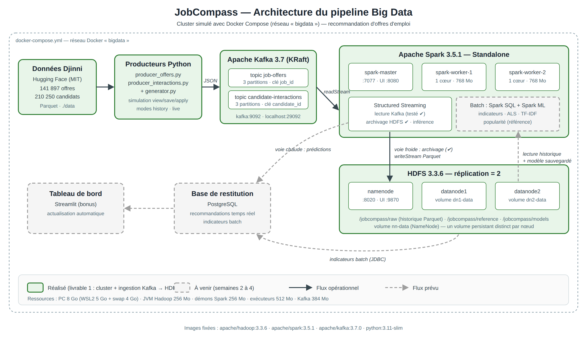
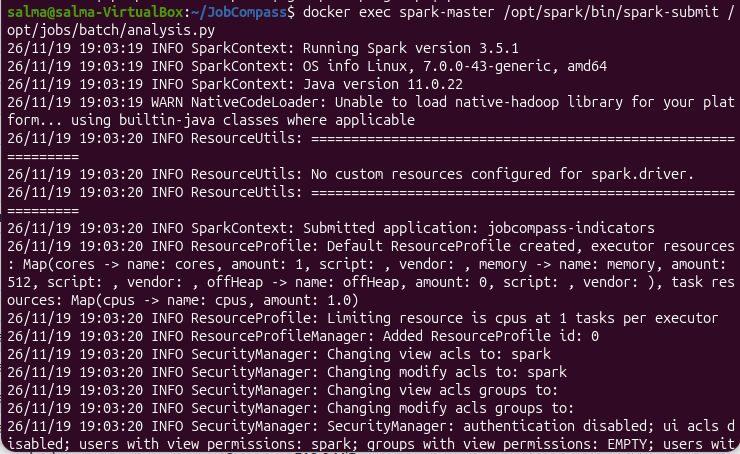
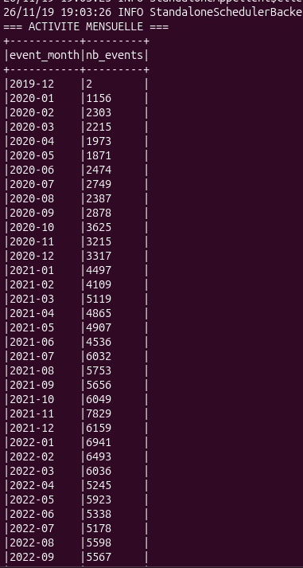
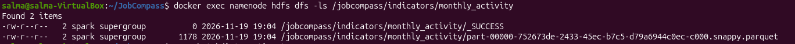
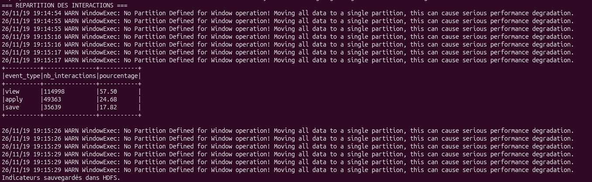
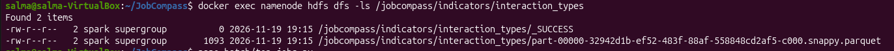
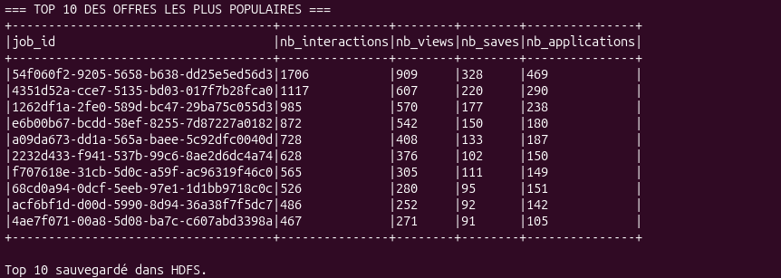
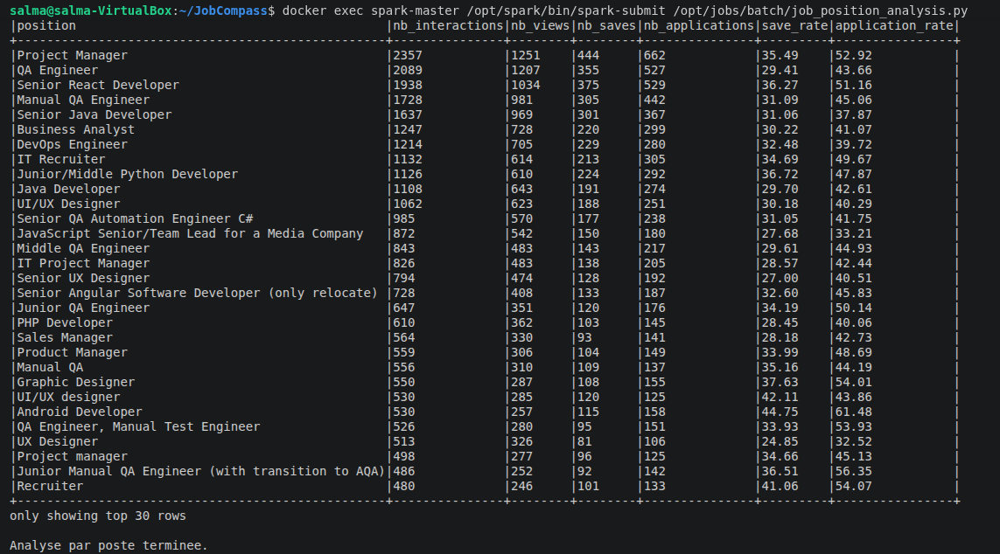

# JobCompass — Pipeline Big Data de recommandation d'offres d'emploi

Plateforme de recommandation d'offres d'emploi basée sur les compétences et le profil des candidats.
Projet des modules **Big Data Plateformes** et **Big Data Analytics** (Pr. El Ghali Btihal).

Le pipeline collecte un flux d'événements dans **Kafka**, l'archive dans **HDFS**, produit des analyses
historiques et entraîne un modèle de recommandation avec **Spark ML**, puis réalise des recommandations
en temps réel avec **Spark Structured Streaming**. Le tout tourne sur un cluster distribué simulé avec **Docker**.




## Pile technique (versions fixées)

| Composant | Image / version | Rôle |
|---|---|---|
| HDFS | `apache/hadoop:3.3.6` | Stockage distribué : 1 NameNode + 2 DataNodes, réplication 2 |
| Spark | `apache/spark:3.5.1` | Traitement : 1 Master + 2 Workers (Standalone) |
| Kafka | `apache/kafka:3.7.0` | Ingestion : broker unique en mode KRaft (sans Zookeeper) |
| Producteurs | `python:3.11-slim` + `confluent-kafka 2.5.3` | Publication des offres et des interactions |

## Arborescence

```
JobCompass/
├── docker-compose.yml        # Définition de tout le cluster
├── .env.example              # Variables d'environnement (à copier en .env)
├── infra/
│   ├── hadoop.env            # Configuration HDFS (réplication, ports, mémoire)
│   └── spark-defaults.conf   # Valeurs par défaut de spark-submit
├── ingestion/
│   ├── download_data.py      # Téléchargement des datasets Djinni (Hugging Face)
│   ├── inspect_data.py       # Inspection des colonnes
│   ├── generator.py          # Simulation des interactions candidat ↔ offre
│   ├── producer_offers.py    # Producteur Kafka : topic job-offers
│   ├── producer_interactions.py  # Producteur Kafka : topic candidate-interactions
│   ├── Dockerfile
│   └── requirements.txt
├── batch/
│   ├── test_hdfs.py          # Test Spark ↔ HDFS (réplication)
│   └── check_raw.py          # Vérification de l'historique archivé
├── streaming/
│   ├── test_kafka_stream.py  # Test de lecture Kafka (console)
│   └── archive_to_hdfs.py    # Archivage Kafka → HDFS en Parquet (voie froide)
├── dashboard/                # Tableau de bord (à venir)
└── docs/
    ├── architecture.png / .svg
    ├── donnees.md            # Documentation des données et de la simulation
    └── preuves/              # Captures de validation
```

## Prérequis

- **Docker Desktop** avec le moteur WSL 2 (Windows) ou Docker Engine + Docker Compose v2 (Linux/macOS).
- **8 Go de RAM minimum**. Sous Windows, donner au moins 5 Go à WSL (voir ci-dessous).
- **Python 3** et `pip`, uniquement pour télécharger les données.
- Environ **8 Go d'espace disque** (images Docker + données).

### Réglage de la mémoire WSL (Windows, PC 8 Go)

Dans PowerShell :

```powershell
Set-Content -Path "$env:USERPROFILE\.wslconfig" -Value "[wsl2]`nmemory=5GB`nswap=4GB"
wsl --shutdown
```

Puis relancer Docker Desktop. La configuration du cluster est déjà allégée pour tenir dans cette mémoire.

## Lancement pas à pas

Toutes les commandes se lancent depuis la racine du dépôt (sous Windows : dans le terminal Ubuntu WSL).

### 1. Cloner le dépôt et préparer la configuration

```bash
git clone https://github.com/FatimZahra-Houssat27/JobCompass.git
cd JobCompass
cp .env.example .env
```

### 2. Télécharger les données (~380 Mo, non versionnées)

```bash
python3 -m venv .venv
source .venv/bin/activate
pip install huggingface_hub pandas pyarrow
python ingestion/download_data.py
```

Les fichiers Parquet sont placés dans `data/`. Test optionnel du générateur, sans Kafka :

```bash
python ingestion/generator.py
```

### 3. Construire l'image des producteurs

```bash
docker compose build producer-interactions
```

### 4. Démarrer le cluster

```bash
docker compose up -d
docker compose ps -a
```

Attendre que `kafka` soit **(healthy)** et que `init-topics` soit **Exited (0)** : les topics
`job-offers` et `candidate-interactions` sont alors créés (3 partitions chacun).

### 5. Constituer l'historique

```bash
# 200 000 interactions simulées (2020–2023), envoyées au plus vite
docker compose run --rm producer-interactions producer_interactions.py --mode history --events 200000

# 5 000 offres d'emploi
docker compose run --rm producer-offers producer_offers.py --limit 5000 --rate 0
```

### 6. Lancer le flux temps réel

```bash
docker compose --profile producers up -d producer-interactions
```

Le producteur envoie 20 interactions par seconde (`EVENTS_PER_SEC` dans `.env`).

### 7. Lire le flux avec Spark Structured Streaming

```bash
docker exec -it spark-master /opt/spark/bin/spark-submit \
  --packages org.apache.spark:spark-sql-kafka-0-10_2.12:3.5.1 \
  /opt/jobs/streaming/test_kafka_stream.py
```

Des micro-batchs (`Batch: 1`, `Batch: 2`…) s'affichent. Arrêter avec `Ctrl + C`.

### 8. Archiver le flux Kafka dans HDFS (voie froide)

```bash
docker exec -it spark-master /opt/spark/bin/spark-submit \
  --packages org.apache.spark:spark-sql-kafka-0-10_2.12:3.5.1 \
  /opt/jobs/streaming/archive_to_hdfs.py
```

Le job lit les deux topics depuis le début et écrit en Parquet, partitionné par mois, dans
`/jobcompass/raw/candidate_interactions/` et `/jobcompass/raw/job_offers/`. Les checkpoints sont dans
`/jobcompass/checkpoints/` : après un arrêt (`Ctrl + C`), une relance reprend exactement là où le job
s'était arrêté, sans perte ni doublon. Laisser tourner au moins 2 minutes pour archiver l'historique.

Vérifier l'historique archivé :

```bash
docker exec spark-master /opt/spark/bin/spark-submit /opt/jobs/batch/check_raw.py
docker exec namenode hdfs dfs -ls /jobcompass/raw/candidate_interactions | head
```

## Vérifications

| Vérification | Commande ou URL | Résultat attendu |
|---|---|---|
| DataNodes HDFS | `docker exec namenode hdfs dfsadmin -report \| grep "Live datanodes"` | `Live datanodes (2)` |
| Interface HDFS | http://localhost:9870 | 2 DataNodes *In service* |
| Interface Spark | http://localhost:8080 | `Alive Workers: 2` |
| Spark ↔ HDFS | `docker exec spark-master /opt/spark/bin/spark-submit /opt/jobs/batch/test_hdfs.py` | `Lignes relues depuis HDFS : 100000` |
| Réplication | `docker exec namenode hdfs fsck /jobcompass/test_spark -files -blocks` | `Average block replication: 2.0` |
| Topics Kafka | `docker exec kafka /opt/kafka/bin/kafka-topics.sh --bootstrap-server kafka:9092 --describe` | 2 topics, 3 partitions |
| Archive HDFS | `docker exec spark-master /opt/spark/bin/spark-submit /opt/jobs/batch/check_raw.py` | Nombre d'événements archivés, répartition view/save/apply |
| Messages | `docker exec kafka /opt/kafka/bin/kafka-console-consumer.sh --bootstrap-server kafka:9092 --topic candidate-interactions --from-beginning --max-messages 5` | 5 événements JSON |

Les captures de ces vérifications sont dans [`docs/preuves/`](docs/preuves/).

## Arrêt

```bash
docker compose --profile producers stop   # arrêter les producteurs
docker compose stop                       # arrêter le cluster (données HDFS conservées)
docker compose down -v                    # tout supprimer, y compris les volumes HDFS
```

## Dépannage

| Problème | Solution |
|---|---|
| `kafka is unhealthy` | Patienter (le healthcheck tolère 90 s de démarrage), puis relancer `docker compose up -d`. |
| Terminal ou WSL qui ne répond plus | Mémoire saturée : `wsl --shutdown` dans PowerShell, vérifier `.wslconfig`, relancer Docker Desktop. |
| `failed to connect to the docker API` | Docker Desktop n'est pas démarré, ou l'intégration WSL est désactivée (*Settings → Resources → WSL integration*). |
| `Initial job has not accepted any resources` | Un ancien job Spark occupe les workers : `docker exec spark-master pkill -f SparkSubmit`. Toujours lancer les jobs de streaming avec `docker exec -it` pour que Ctrl + C les arrête vraiment. |
| Facteur de réplication 3 au lieu de 2 | Le client Spark utilise sa propre configuration : `spark.hadoop.dfs.replication 2` dans `infra/spark-defaults.conf`, puis `hdfs dfs -setrep -R 2 /jobcompass`. |
| `port is already allocated` | Un autre conteneur utilise 8080, 9870 ou 29092 : `docker ps`, puis `docker stop <conteneur>`. |

## Données

Dataset **Djinni Recruitment Dataset** (offres et profils candidats anonymisés, en anglais), licence MIT.
Les interactions candidat ↔ offre sont **simulées** : voir [`docs/donnees.md`](docs/donnees.md).

# Livrable 2 — Analyse batch avec Spark SQL

## 1. Objectif du livrable

L'objectif de ce livrable est de réaliser une analyse batch des données historiques du projet JobCompass à l'aide de **Apache Spark** et **Spark SQL**.

Les traitements permettent de calculer plusieurs indicateurs à partir des interactions des utilisateurs avec les offres d'emploi, puis de sauvegarder les résultats dans HDFS au format Parquet.

Les indicateurs étudiés sont :

- L'évolution mensuelle de l'activité.
- La répartition des interactions par type.
- Le classement des dix offres ayant reçu le plus d'interactions.

## 2. Environnement technique

Les technologies utilisées pour réaliser ce livrable sont :

- **Apache Spark 3.5.1** : traitement distribué des données.
- **Spark SQL** : analyse et agrégation des données.
- **HDFS** : stockage distribué des données et des résultats.
- **Docker** : exécution des différents services dans des conteneurs.
- **Python / PySpark** : développement des scripts de traitement.
- **Format Parquet** : stockage des indicateurs calculés.

### Architecture du cluster

Le cluster utilisé est composé de :

- Un Spark Master.
- Deux Spark Workers.
- Un NameNode HDFS.
- Deux DataNodes HDFS.

Les deux Workers sont actifs et connectés au Master.

### Captures d'écran

**Figure 1 — État du cluster Spark**


**Figure 2 — Applications Spark exécutées avec succès**


## 3. Organisation des scripts batch

Les scripts développés pour ce livrable se trouvent dans le dossier `batch/` :

```text
batch/
├── analysis.py
├── interaction_types.py
└── top_jobs.py
```

Chaque script réalise un traitement spécifique sur les données historiques stockées dans HDFS.

Les traitements utilisent les données antérieures au 1er janvier 2024.

## 4. Indicateur 1 — Évolution mensuelle de l'activité

### Objectif

Analyser l'évolution du nombre d'interactions enregistrées chaque mois afin d'identifier les périodes de forte et de faible activité.

### Traitement réalisé

Le script utilisé est :

```text
batch/analysis.py
```

Il réalise les opérations suivantes :

1. Lecture des données historiques depuis HDFS.
2. Filtrage des interactions antérieures au 1er janvier 2024.
3. Regroupement des interactions par mois.
4. Calcul du nombre total d'interactions pour chaque mois.
5. Sauvegarde du résultat au format Parquet dans HDFS.

### Exécution

```bash
docker exec spark-master /opt/spark/bin/spark-submit /opt/jobs/batch/analysis.py
```

### Résultat obtenu

La période analysée s'étend de décembre 2019 à octobre 2023.

Le mois de novembre 2021 représente le pic d'activité avec **7 829 interactions**.

### Interprétation

Cet indicateur permet d'observer l'évolution de l'activité des utilisateurs au fil du temps. Le pic enregistré en novembre 2021 indique une période particulièrement active sur la plateforme.

**Figure 3 — Résultats de l'activité mensuelle**



**Figure 4 — Affichage des résultats de l'activité mensuelle**



**Figure 5 — Vérification de la sauvegarde dans HDFS**



## 5. Indicateur 2 — Répartition des interactions par type

### Objectif

Étudier la répartition des interactions des utilisateurs selon leur type :

- `view` : consultation d'une offre.
- `save` : sauvegarde d'une offre.
- `apply` : candidature à une offre.

### Traitement réalisé

Le script utilisé est :

```text
batch/interaction_types.py
```

Il effectue les opérations suivantes :

1. Lecture des interactions historiques depuis HDFS.
2. Filtrage des données antérieures au 1er janvier 2024.
3. Regroupement des interactions par type.
4. Calcul du nombre d'interactions pour chaque type.
5. Calcul du pourcentage de chaque type par rapport au total.
6. Sauvegarde des résultats dans HDFS au format Parquet.

### Exécution

```bash
docker exec spark-master /opt/spark/bin/spark-submit /opt/jobs/batch/interaction_types.py
```

### Résultats obtenus

Le nombre total d'interactions analysées est de **200 000**.

| Type d'interaction | Nombre | Pourcentage |
|---|---:|---:|
| view | 114 998 | 57,50 % |
| apply | 49 363 | 24,68 % |
| save | 35 639 | 17,82 % |
| **Total** | **200 000** | **100 %** |

### Interprétation

Les consultations (`view`) représentent la majorité des interactions avec 57,50 % du total.

Les candidatures (`apply`) représentent 24,68 %, tandis que les sauvegardes (`save`) représentent 17,82 %.

Cela montre que les utilisateurs consultent davantage les offres que les autres actions proposées sur la plateforme.

**Figure 6 — Répartition des interactions par type**



**Figure 7 — Vérification de la sauvegarde des interactions dans HDFS**



## 6. Indicateur 3 — Top 10 des offres les plus populaires

### Objectif

Identifier les dix offres d'emploi qui ont reçu le plus grand nombre d'interactions.

### Traitement réalisé

Le script utilisé est :

```text
batch/top_jobs.py
```

Il réalise les opérations suivantes :

1. Lecture des interactions historiques depuis HDFS.
2. Filtrage des interactions antérieures au 1er janvier 2024.
3. Regroupement des interactions par identifiant d'offre (`job_id`).
4. Calcul du nombre total d'interactions pour chaque offre.
5. Calcul du nombre de consultations (`views`), de sauvegardes (`saves`) et de candidatures (`applications`).
6. Tri des offres par nombre total d'interactions décroissant.
7. Sélection des dix premières offres.
8. Sauvegarde du résultat dans HDFS au format Parquet.

### Exécution

```bash
docker exec spark-master /opt/spark/bin/spark-submit /opt/jobs/batch/top_jobs.py
```

### Résultat obtenu

L'offre la plus populaire identifiée est :

| Indicateur | Valeur |
|---|---:|
| Identifiant de l'offre | `54f060f2-9205-5658-b638-dd25e5ed56d3` |
| Nombre total d'interactions | 1 706 |
| Consultations | 909 |
| Sauvegardes | 328 |
| Candidatures | 469 |

### Interprétation

Cette analyse permet d'identifier les offres qui suscitent le plus d'intérêt auprès des utilisateurs.

L'offre présentée ci-dessus arrive en première position avec 1 706 interactions. Elle a enregistré 909 consultations, 328 sauvegardes et 469 candidatures.

Cet indicateur peut aider à comprendre les offres les plus attractives sur la plateforme.

**Figure 8 — Classement des dix offres les plus populaires**


## 7. Indicateur 4 — Analyse des performances par poste

### Objectif

Analyser les interactions des utilisateurs selon le poste proposé dans les offres d'emploi afin d'identifier les catégories de postes qui suscitent le plus d'intérêt.

### Traitement réalisé

Le script utilisé est :

```text
batch/job_position_analysis.py
```

Il réalise les opérations suivantes :

1. Lecture des interactions historiques depuis HDFS.
2. Lecture des offres d'emploi depuis HDFS.
3. Jointure entre les interactions et les offres à partir de `job_id` et `id`.
4. Regroupement des résultats selon le poste (`Position`).
5. Calcul du nombre total d'interactions, de consultations, de sauvegardes et de candidatures.
6. Calcul du taux de sauvegarde et du taux de candidature par rapport au nombre de consultations.
7. Sauvegarde des résultats dans HDFS au format Parquet.

### Exécution

```bash
docker exec spark-master /opt/spark/bin/spark-submit /opt/jobs/batch/job_position_analysis.py
```
### Capture d'écran des résultats

**Figure 9 — Résultats de l'analyse des performances par poste**



### Analyse des taux

Deux indicateurs supplémentaires sont calculés :

- **Taux de sauvegarde** : rapport entre le nombre de sauvegardes et le nombre de consultations.
- **Taux de candidature** : rapport entre le nombre de candidatures et le nombre de consultations.

Par exemple, pour le poste Project Manager, le taux de sauvegarde est de 35,49 % et le taux de candidature est de 52,92 %.

### Interprétation

Cette analyse permet de constater que l'intérêt des utilisateurs varie selon les postes proposés.

Le poste Project Manager présente le plus grand nombre d'interactions parmi les résultats affichés. Le poste QA Engineer arrive en deuxième position, suivi de Senior React Developer.

Les taux de sauvegarde et de candidature permettent également d'étudier l'engagement des utilisateurs au-delà du simple nombre de consultations.

Ces indicateurs peuvent aider à identifier les catégories de postes qui attirent le plus les candidats et celles qui génèrent davantage de candidatures.


## 8. Organisation des résultats dans HDFS

Les résultats des trois traitements batch sont sauvegardés dans HDFS au format Parquet.

L'organisation des résultats est la suivante :

```text
/jobcompass/
└── indicators/
    ├── monthly_activity/
    ├── interaction_types/
    └── top_jobs/
```

Chaque dossier contient :

- Un fichier `_SUCCESS` indiquant que l'écriture du résultat s'est terminée avec succès.
- Un ou plusieurs fichiers `part-...snappy.parquet` contenant les données calculées.

### Vérification des résultats dans HDFS

Les commandes suivantes permettent de vérifier la présence des résultats :

```bash
docker exec namenode hdfs dfs -ls /jobcompass/indicators/monthly_activity
```

```bash
docker exec namenode hdfs dfs -ls /jobcompass/indicators/interaction_types
```

```bash
docker exec namenode hdfs dfs -ls /jobcompass/indicators/top_jobs
```

Les trois dossiers de résultats ont été créés avec succès dans HDFS.

## 9. Documentation des indicateurs

Les indicateurs calculés sont expliqués dans le fichier :

```text
docs/indicateurs.md
```

Ce document présente les objectifs de chaque indicateur, les résultats obtenus, leur interprétation et leurs limites.

## 10. Bilan du Livrable 2

Ce livrable a permis de mettre en place et d'exécuter une chaîne de traitement batch avec Apache Spark et HDFS.

Les trois scripts PySpark ont été exécutés avec succès et les résultats ont été sauvegardés dans HDFS au format Parquet.

Les principaux résultats obtenus sont :

- Analyse de l'évolution mensuelle de l'activité.
- Identification de novembre 2021 comme le mois le plus actif, avec 7 829 interactions.
- Analyse de 200 000 interactions et calcul de leur répartition par type.
- Identification des dix offres ayant reçu le plus d'interactions.
- Sauvegarde et vérification des résultats dans HDFS.

**Conclusion :** le Livrable 2 a permis de réaliser une analyse batch des données historiques de JobCompass, de produire des indicateurs utiles à la compréhension de l'activité de la plateforme et de stocker les résultats dans le système distribué HDFS.
